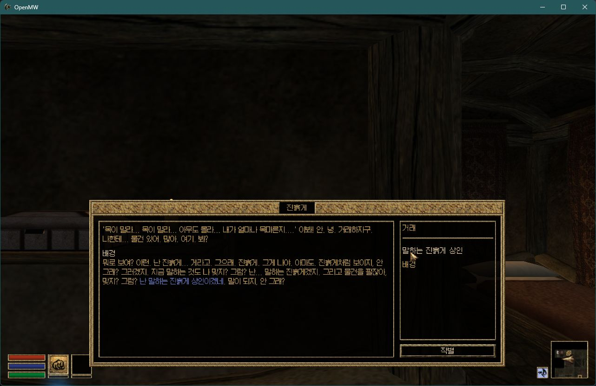
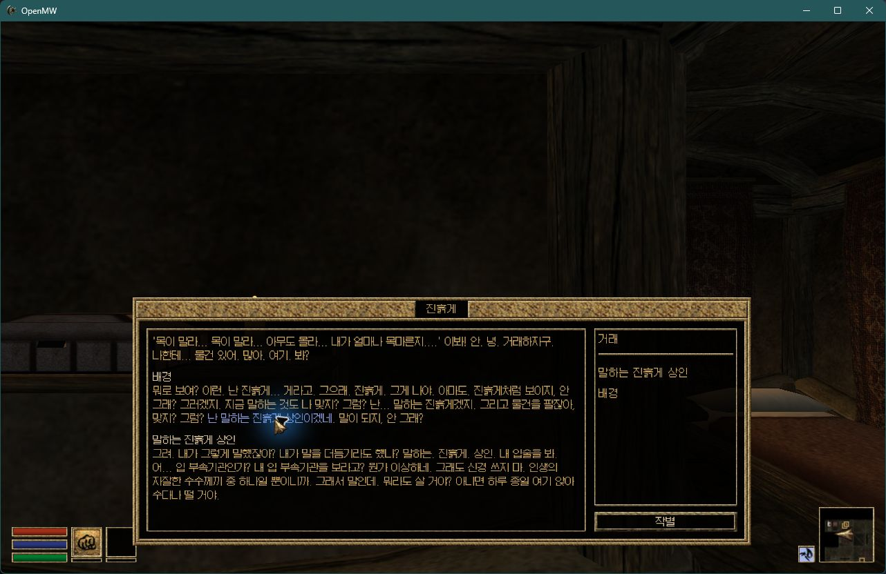
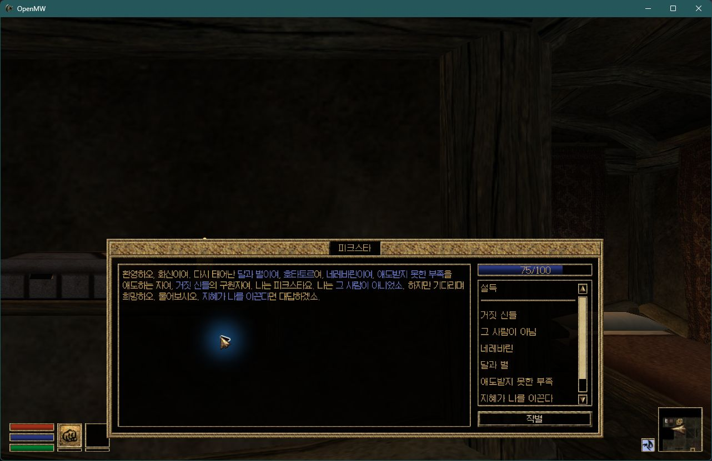
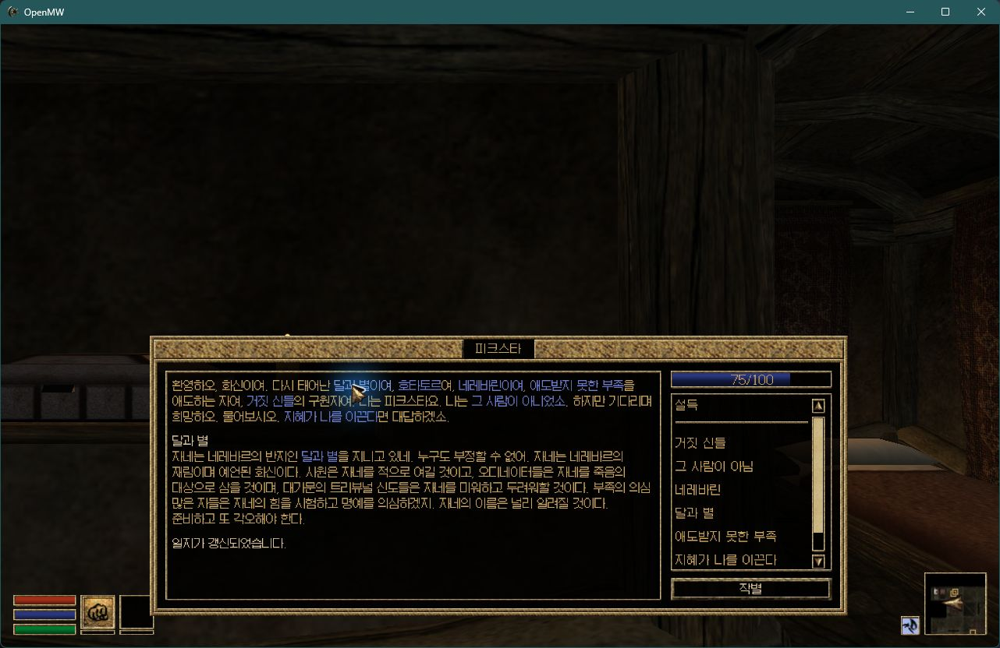
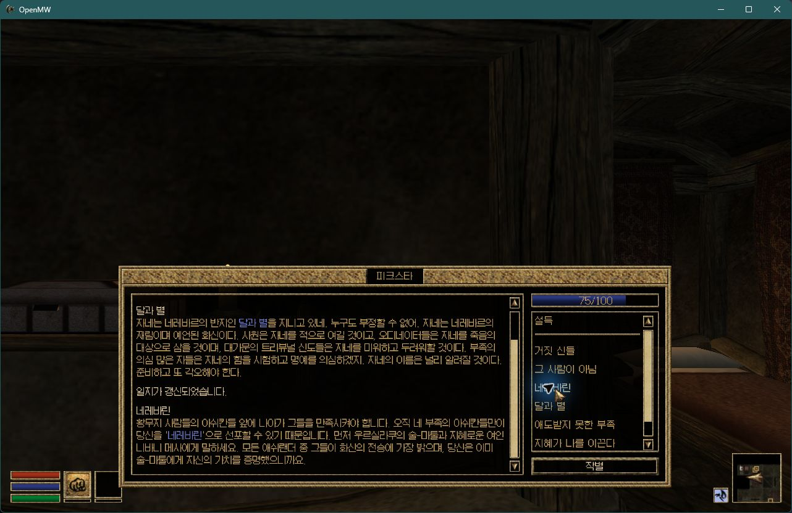

# #42 현행판 재검수와 남은 링크 교정

기준은 Windows KR12.9와 #66 지역 기본 토픽 후보이다. 아래 데이터는 별도 후보이며
사용자 설치·원본 게임·플레이 세이브에는 적용하지 않았다. 엔진 변경은 없다.

## 제보 목록의 판정

원래 426개 CSV를 `(DIAL, INFO.INAM)`으로 식별하고, 공식 영문 3개 마스터의
INFO 조건 지문과 실제 OpenMW KeywordSearch 결과를 함께 대조했다.
동일 INAM만으로 다른 주제의 응답을 섞지 않는다.

| 426개 제보 후보 | 수 |
|---|---:|
| KR12.9에서 이미 연결됨 | 164 |
| 이번 후보에서 복구 | 67 |
| 더 구체적인 정상 토픽을 보존 | 36 |
| 원본에서도 그 토픽으로 파싱되지 않음 | 154 |
| 다른 의미의 단어·언어·형용사 | 5 |

마지막 5개는 드웨머어 번역 열쇠, 수지성 2개, 오크식 방어구, 조언자이다.
`counselor`를 `counsel`로, `iron`과 무관한 철학·철퇴를 철로 연결하지 않는다.
36개는 가입·선언·보호·길드 교관·흉가·질병 등 실제로 더 구체적인 목적지로 향한다.
짧은 토픽을 강제해서 이 링크들을 가리지 않는다.

습득 경로 후보 71개도 각각 원본과 대조했다. 10개는 현행판에 화자 호환 링크가 있고,
알드메리스는 `알드메리스어`가 나온 6개 응답의 언어 명칭을 연결해 복구했다.
59개는 원본에도 같은 정적 경로 제한이 있다. 나머지 다트 1개는 원본의
`Black Dart Gang` 조직명을 무기 다트와 혼동한 부분 문자열 일치다.
조건 지문이 여러 영어 주제와 중복되는 4개 항목은 실제 주제 의미를 확인해
관련 없는 대응 후보를 분리했다.

전수 행별 판정:
[426개](../../../translations/openmw-kr/issue42_reported_426_review_20261111.json),
[71개](../../../translations/openmw-kr/issue42_reported_71_review_20261111.json).
이는 원작 모든 퀘스트의 도달 가능성 증명이 아니다. 화자 ID·종족·직업·세력·셀의
정적 호환성과 스크립트 텍스트의 AddTopic을 비교했으며 SCVR·저널 진행 전체를 모의하지 않는다.

## 실제 수정

총 **105개 INFO.NAME**과 새 TOP 별칭 **53개**만 바꾼다.
67개 제보 누락 및 알드메리스 6개로 본편 구성에서 새 목적지 73개를 복구한다.
진흙게 상인, 피크스타의 달과 별/네레바린, 우르실라쿠 네레바린, 프렐류드호,
승진·스칼 일체성 등의 명시 링크를 보강했다.

조사 `이`/`것이`가 조언으로, 동사 어미가 상의로 연결되던 저널 태그도
해당 의미의 구절로 옮기거나 잘못된 목적지만 제거했다. 선호 능력치의
`favored`는 부탁이 아니고, 제국의 아홉 지방은 임페리얼 종족이 아니다.
본편에서 잘못된 목적지 12개를 의도적으로 제거했으며 정상 목적지 손실은 0이다.
명시 태그의 표시 범위를 넓힐 때 기존 상의 링크를 가리는 두 사례는 기존대로 보존했다.

화면에 보이는 한국어는 모두 동일하다. INFO의 ID·순서·조건·퀘스트 스크립트·바이트코드,
다른 레코드, 기존 TOP 내용, MRK/JRN/CEL은 보존한다.
신규 별칭은 기존 first-wins 매핑을 덮어쓰지 않는다.

## 검증

- 소스 ZIP SHA 고정, 각 수정 INFO 몸체 SHA 고정. 새 디렉터리에만 후보 생성.
- 입력 변조·중복 INFO·별칭 충돌·잘린 레코드·표시 문장 변경 차단 등 단위 검사 5개 통과.
- 공식 3개 마스터를 포함한 **12개 구성, 858,004개 구성별 INFO**에서
  실제 OpenMW 네이티브 파서의 습득 모드와 화면 표시 모드를 각각 비교.
  **미검수 응답 변화 0, 정상 링크 손실 0, 표시 문장 변화 0**.
  PFP는 본편 한글 ESP 뒤/지역 모드 앞에 둔다.
  Rebirth 지역 대체 ESM과 일반 Cyr/Sky를 동시에 활성화하지 않는다.
- [빌드 검증](2026-11-11_issue42_reviewed_build.json),
  [구성별 원시 결과와 제거한 잘못된 목적지](2026-11-11_issue42_reviewed_native.json).
- Windows 후보 재생성 CI 통과 후, 기존 지역 데이터 검사에서 오래된 TOP manifest 해시가
  발견됐다. 현재 TOP의 중복·BOM·MRK/JRN 대응과 모든 데이터 검사를 먼저 확인한 뒤
  Cyr/Sky/TD manifest의 TOP 해시와 별칭 수만 갱신했다. TOP 파일과 바이너리는 변경하지 않았다.

격리된 실제 KR12.9에서 진흙게 상인을 테스트 셀에 생성했다.
처음에는 배경만 알도록 설정한 새 캐릭터가 배경 응답을 읽은 뒤
`말하는 진흙게 상인`을 배우고, 응답 안의 새 링크를 클릭해 해당 응답이 출력됨을 확인했다.




피크스타도 테스트 셀에 생성하되 실제 응답 조건에 맞춰 `A2_6_Incarnate = 50`인
새 캐릭터를 사용했다. 인사말에서 달과 별·네레바린을 배우고, 각각 클릭해
올바른 응답과 달과 별 응답의 일지 갱신을 확인했다. 전체 퀘스트를 자연 진행한 시험은 아니다.





제국 교단 에본하트·문모스 가입 및 Rebirth 전사 길드 실제 가입 완료 증거는
[같은 날짜의 게임 검증 보고서](2026-11-11_shared_default_topics.md)에 있다.
모든 NPC·퀘스트를 끝까지 플레이한 결과로 해석하지 않는다.
Ubuntu 엔진이나 Android APK는 이번 데이터 수정에 맞춰 새로 빌드하지 않았다.

```powershell
python packaging/korean/tooling/repair_reviewed_issue42_links.py `
  --source '<공개 KR12.9 Full ZIP>' --output '<새 후보 디렉터리>'
python -m unittest discover -s packaging/korean/tooling -p test_reviewed_issue42_links.py -v
python packaging/korean/tooling/verify_reviewed_issue42_links.py `
  --source '<공개 ZIP 모음>' --regional '<#66 지역 후보 ZIP 모음>' `
  --candidate '<본편 후보 디렉터리>' --masters '<개인 소유 Data Files>' `
  --runner '<Windows 네이티브 검사기>' --pfp '<PFP 디렉터리>'
```
