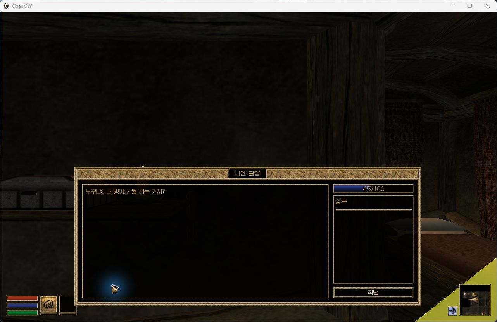
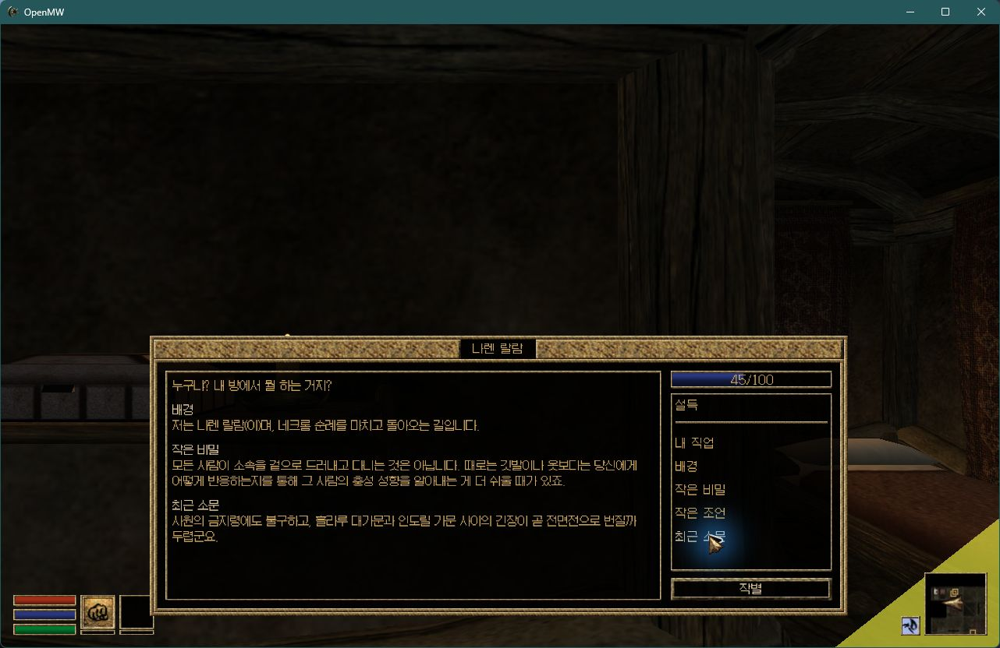
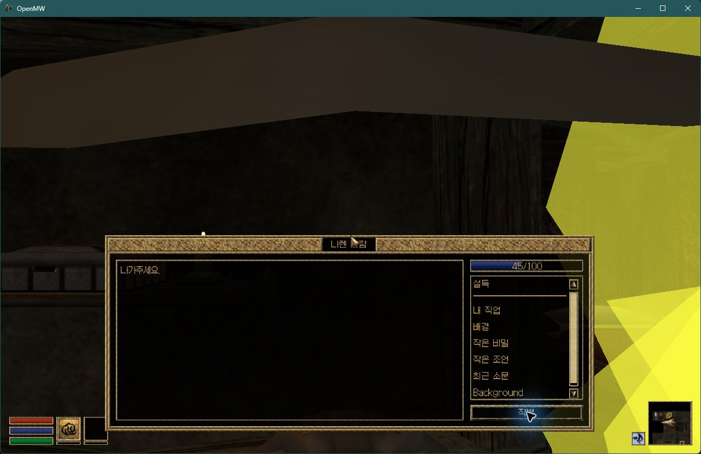
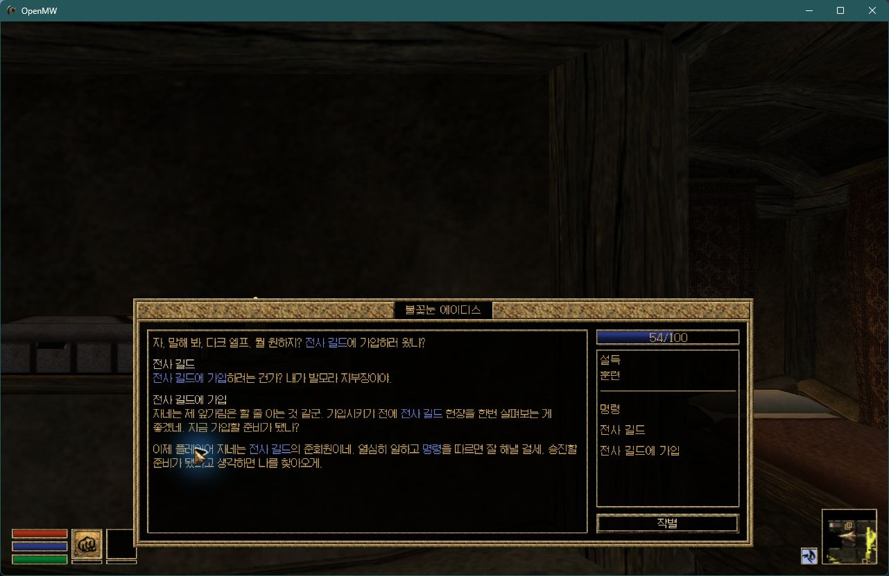
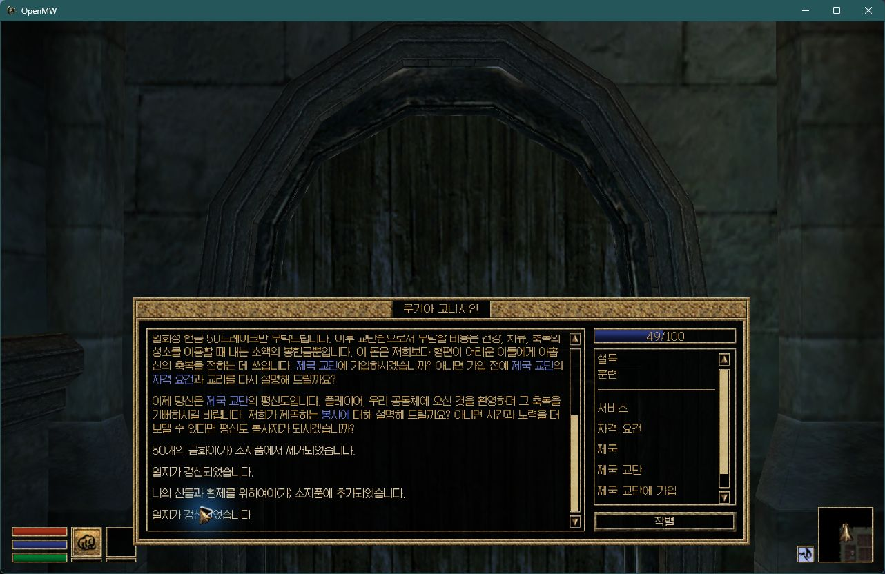
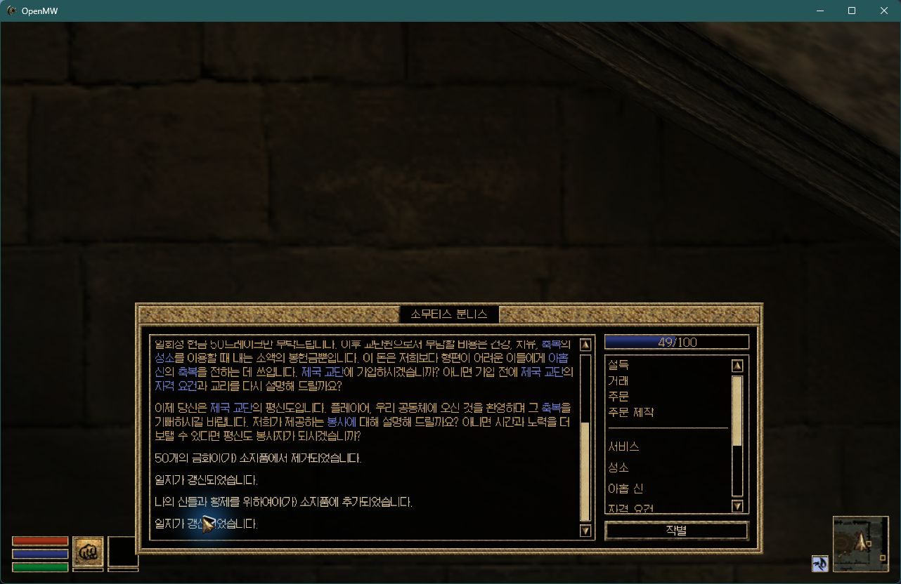

# 지역 NPC 기본 대화 주제 복구와 길드 가입 실게임 확인

2026-11-11 KST. 기준은 Windows KR12.9, TD/TR/Cyr 및 지역 호환 kr0.3,
Sky kr0.2, Rebirth 7.2 kr1.2. **이 문서의 지역 수정 후보는 아직 정식 배포하지 않았다.**

## #66: 원인과 수정

본편은 공통 DIAL을 한국어 ID로 옮기고 원래 영어 DIAL을 삭제한다.
예를 들어 시작 시 Sellus Gravius가 알려 주는 주제는 `최근 소문`, `작은 비밀`,
`서비스` 등이다. 지역 모드는 해당 응답을 `latest rumors`, `little secret`,
`Services` 아래에 추가한다. OpenMW는 플레이어가 아는 ID와 NPC의 응답 ID를
교집합으로 표시하므로, 한국어 주제를 배워도 지역 NPC의 영어 ID 응답은 표시되지 않는다.
TOP/MRK 문자열 검사만으로는 이 차이를 발견할 수 없다.

기존 영어 DIAL/INFO는 모두 유지하고, 아래 8개 공통 한국어 DIAL에 해당 지역
INFO를 그대로 추가한다. 새로운 호환 플러그인이나 엔진 패치는 필요 없다.

| 원래 ID | 본편 공통 ID |
|---|---|
| Background | 배경 |
| latest rumors | 최근 소문 |
| little secret | 작은 비밀 |
| little advice | 작은 조언 |
| my trade | 내 직업 |
| Services | 서비스 |
| someone in particular | 특정 인물 |
| specific place | 특정 장소 |

| 파일 | 추가 한국어 DIAL | 그대로 복제한 INFO |
|---|---:|---:|
| Tamriel_Data.esm | 4 | 151 |
| TR_Mainland.esm | 8 | 7,838 |
| Cyr_Main.ESM | 8 | 1,857 |
| Sky_Main.ESM | 8 | 619 |
| Project Cyrodiil [For Rebirth].esm | 8 | 1,857 |
| Skyrim Home of the Nords [For Rebirth].esm | 8 | 619 |
| 합계 | 44 | 12,941 |

이는 **새 번역 12,941건이 아니다.** 같은 응답을 이미 배운 한국어 주제에서도
찾게 하는 복제다. 기존 모든 레코드는 바이트 그대로이고, 기존 TES3 헤더에서는
HEDR의 레코드 수 4바이트만 증가한다. 추가 DIAL의 NAME 외에는 복제본도 원본과
동일하다. PNAM/NNAM 순서, NPC·세력·장소·퀘스트 조건, 결과 스크립트와 바이트코드,
TOP/MRK/JRN/CEL, 리소스와 다른 ZIP 항목을 변경하지 않는다.

## 검증

- 공개 ZIP 6개 및 Rebirth ZIP SHA 고정. 빌더의 전체 물리 레코드·ZIP 항목 대조 통과.
- 보존·누락·중복·손상 입력 차단 단위 검사 6개 통과.
- 본편/PFP/TD/TR/Cyr/Sky/Rebirth 기본·대체/지역 호환 등 **12개 구성**에서
  실제 OpenMW KeywordSearch로 수정 후 **858,007회 INFO 검사**. 반복 구성 포함 수치다.
  기존 토픽 ID 삭제, 기존 응답 삭제, 기존 링크 손실, 보조 파일 변경 모두 **0**.
  추가 응답은 해당 구성에서 실제로 로드된 영어 원본 응답과 몸체·조건·스크립트·검색 결과가
  같은지 대조했다. 본편 응답을 덮어쓴 사례도 0이다.
- 실제 OpenMW KR12.9에서 `TR_m3_Naren Llaram`을 테스트 셀에 놓고,
  본편 시작 대화가 부여하는 한국어 기본 주제 및 배경을 알고 있는 상태로 비교했다.
  원래 지역판은 기본 목록이 비어 있고, 후보는 `내 직업·배경·작은 비밀·작은 조언·최근 소문`이
  표시된다. 배경, 작은 비밀, 최근 소문을 직접 클릭해 응답이 출력됨을 확인했다.
- 기존 지역 데이터에서 영어 `Background`를 대화한 테스트 세이브를 생성했다.
  후보에서 해당 파일을 실제로 불러오고 다시 저장한 뒤 **JOUR 3개 몸체가 모두 바이트 동일**함을
  확인했다. `Background / INFO 11331653322466967` 대화 기록이 보존됐고,
  원래 세이브 SHA도 변하지 않았다. 불러온 상태에서 한국어 기본 목록도 표시된다.

실물 검증 JSON:
[빌드](2026-11-11_shared_default_topics_build.json),
[12개 구성](2026-11-11_shared_default_topics_native.json),
[기존 세이브](2026-11-11_shared_default_topics_save.json).





## #62·#64: KR12.9의 실제 가입 경로

- Rebirth 7.2 kr1.2 + 본편 KR12.9: 에이디스에게 `전사 길드 → 전사 길드에 가입 →
  가입하겠습니다`를 선택해 준회원 가입 완료 응답과 명령 토픽을 확인했다.
  테스트 캐릭터의 가입 자격 능력치는 사전에 충족시켰다.
- 에본하트 Ruccia Conician, 문모스 Somutis Vunnis: 각각 별도 새 캐릭터로
  `평신도 회원 → 제국 교단에 가입 → 제국 교단에 가입한다`를 선택했다.
  평신도 가입 완료 응답, 금화 50개 차감, 책 지급과 일지 갱신을 직접 확인했다.
- 이 세 경로에는 이번 지역 데이터 복제가 필요하지 않았다. **기존 KR12.9에서 이미 동작한다.**
  따라서 해당 제보의 KR12.8 회귀를 최신판에서 재현됐다고 보고하지 않는다.





## 재현과 적용 범위

```powershell
python packaging/korean/tooling/repair_shared_default_topics.py `
  --source '<KR12.9 공개 ZIP 모음>' --output '<새 후보 폴더>'
python -m unittest discover -s packaging/korean/tooling -p test_shared_default_topics.py -v
python packaging/korean/tooling/verify_shared_default_topics.py `
  --source '<KR12.9 공개 ZIP 모음>' --candidate '<후보 폴더>' `
  --masters '<개인 소유 원본 Data Files>' --runner '<OpenMW 네이티브 검사기>' `
  --pfp '<선택 PFP 폴더>'
```

검사기는 기존 `verify-journal-links.cpp`를 사용한다.
원본 ESM과 사용자 세이브는 공개 저장소/CI에 올리지 않는다.
후보 ZIP은 기존 모드 내부 ESM만 교체한다. 파일명·의존성과 기존 로드 순서를 유지하며,
본편 한글 ESP는 공식 3개 마스터 바로 다음, PFP·지역 모드 앞에 둔다.
현재 사용자 설치와 실제 플레이 세이브에는 후보를 적용하지 않았다.

영어 기본 주제를 이미 배운 세이브는 영어·한국어 항목이 함께 표시될 수 있다.
기존 영어 대화 기록을 보존하는 현재 방식의 표시상 한계다. 플레이어가 모르는 퀘스트 주제를
일괄 부여하거나 NPC 조건을 완화하지 않는다. 지역 리소스가 없는 격리 테스트 환경에는
메쉬 누락 표시가 있으므로 그래픽 정상 검증으로 해석하지 않는다.
실게임은 대표 TR NPC 및 위 가입 경로를 확인했으며 모든 NPC·플랫폼 전수 플레이는 아니다.
Windows와 같은 데이터 형식이지만 Android 실기 실행은 검증하지 않았다.

**#42의 나머지 의미·토픽 검수와 #63의 미번역 후보 4,187건은 이번 수정으로 완료되지 않는다.**
검증한 후보의 정식 버전 승격과 GitHub/Nexus 배포도 별도 작업이다.
